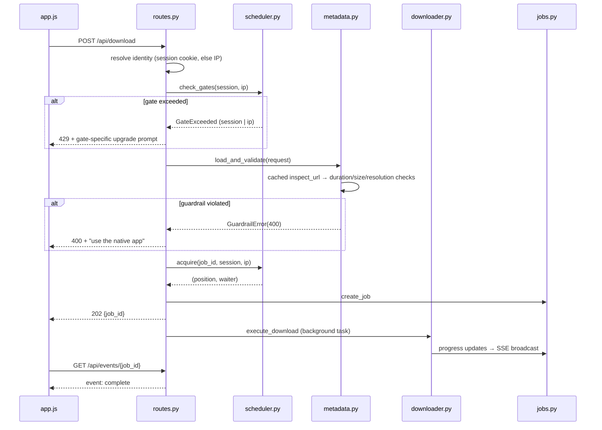
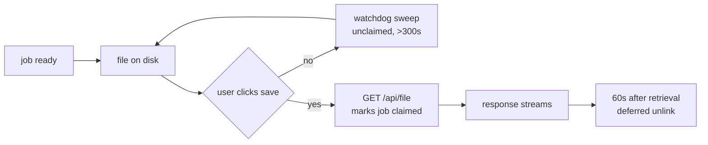
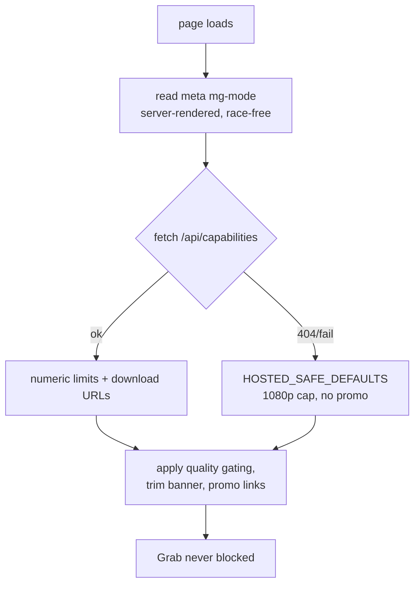

# MediaGrab — Architecture

**Version:** 2.0.0
**Status:** Living document. Describes the system **as built**, not as planned.
**Companions:** [`PRD.md`](./PRD.md) (what it is and why) · [`MULTI_PLATFORM_IMPLEMENTATION_PLAN.md`](./MULTI_PLATFORM_IMPLEMENTATION_PLAN.md) (decisions and milestones) · [`DESIGN.md`](./DESIGN.md) (visual system)

> **This file supersedes the 1.0 PWA-only architecture spec.** Version 1.0 described a
> single-mode browser app with "5-minute post-serve delete". Both are wrong now:
> the system runs in three modes, and retention is 60 seconds post-*retrieval* on
> hosted only, disabled on desktop.

---

## 1. What the system is

One FastAPI codebase, one `/api/` contract, deployed three ways:

| Mode | Where it runs | Limits | Files |
|---|---|---|---|
| **hosted** | Freestyle Linux VM (2 vCPU / 4 GB / 16 GB) | 1080p, 60 min, 1 GB | Zero retention |
| **desktop** | Windows / Linux native app | Unlimited | Saved to `~/Downloads`, never deleted |
| **web** | Browser (PWA) | Same as whichever server answers | — |

The frontend is identical in all three. It learns which mode it is in from a
server-rendered `<meta name="mg-mode">` tag, not from client-side inference.

---

## 2. Principles (still load-bearing)

1. **No database.** Jobs live in memory with TTL expiry; history is `localStorage`.
2. **No frontend bundler.** Vanilla ES6, native `EventSource`, CSS custom properties.
3. **Remux-first.** `-c copy` for AVC1/AAC; trim via `download_ranges` keyframe
   slicing rather than downloading whole streams.
4. **Guardrails are server-authoritative.** Caps are computed from metadata the
   *server* fetched. Client-supplied duration or size is never trusted, so the
   caps cannot be spoofed.

---

## 3. Component map

```text
MediaGrab/
├── app/
│   ├── main.py                  FastAPI factory, lifespan, page rendering
│   ├── config.py                ALL settings; mode-dependent defaults
│   ├── api/
│   │   ├── routes.py            /api/info /download /progress /events /file
│   │   │                        /capabilities /abort /open-folder
│   │   └── schemas.py           Pydantic v2 models
│   └── services/
│       ├── extractor.py         yt-dlp metadata probe → InfoResponse
│       ├── downloader.py        yt-dlp + FFmpeg, progress hooks, cancellation
│       ├── jobs.py              In-memory JobManager, SSE subscriber queues
│       ├── scheduler.py         3-slot FIFO queue + session/IP gates
│       ├── metadata.py          Cached inspection + hosted guardrails
│       ├── network.py           Client IP resolution + signed session identity
│       ├── cleaner.py           Retention daemon (hosted only)
│       ├── templates.py         Server-side mg-mode injection
│       └── downloads.py         Download targets (published vs coming-soon)
├── static/                      index.html, choose.html, downloads.html, app.js
├── run_desktop.py               Launcher; window fallback chain
├── packaging/
│   ├── MediaGrab.spec           PyInstaller onedir build
│   └── fetch_ffmpeg.py          Static FFmpeg bundler
├── deploy/
│   ├── provision.sh             Idempotent VM provisioning
│   ├── push.sh                  Working tree → VM → provision → readiness probe
│   └── mediagrab.service        systemd unit (hosted, retention on)
├── tests/                       124 tests incl. headless-Chromium E2E
└── .github/workflows/build-desktop.yml
```

---

## 4. Request lifecycle (desktop/hosted download)



**Guardrail order matters.** The per-IP gate is checked *before* metadata
extraction, so an over-quota client is rejected without paying for a yt-dlp probe.

---

## 5. The three layers of concurrency control

This is the most subtle part of the system; see §1.1 Decision #2 of the plan.

| Layer | Default (hosted) | Keyed on | Behaviour when full |
|---|---|---|---|
| Global pool | 3 slots | — | FIFO wait, `queue_position` reported |
| Session gate | 1 | HMAC-signed session cookie | **429 immediately** |
| IP ceiling | 3 | Resolved client IP | **429 immediately** |

**Why both secondary gates?** A session cookie alone is defeated by dropping it.
The IP ceiling applies independently, so a client cannot shed its session to
acquire unlimited concurrent downloads. Setting the IP ceiling equal to the pool
size means one IP can never hold more than everything, while two strangers
behind one CGNAT NAT no longer block each other.

**The session token is not authentication.** It is an opaque random ID carrying
no user identity, no PII, and no cross-session linkage. It exists solely to make
the fairness gate sane behind shared NAT.

Two subtleties that caused real bugs, both now covered by tests:

- The gate key must be the **id half** of the token, never the signed envelope.
  Mixing the two splits one client's occupancy across two keys and silently
  disables the gate.
- The freshly-minted token gates the **first** request too, otherwise every new
  client gets one ungated download.

---

## 6. Retention lifecycle (hosted only)



Three deliberate choices:

1. **The clock starts at retrieval, not at job completion.** A user can sit on
   the ready screen indefinitely; the file is not deleted before they save it.
2. **Unclaimed files are exempt from the watchdog** regardless of mtime, so a
   slow-moving user never loses work.
3. **In-flight jobs are always skipped**, matched by the `{job_id}_` prefix
   because a running download has no `file_path` yet.

**Desktop mode disables all of this** (`RETENTION_ENABLED=false`). The output
directory *is* the user's Downloads folder; sweeping it would delete their
files. This is the single most dangerous footgun in the codebase.

---

## 7. Desktop mode specifics

- **Output naming:** bare title, no internal job id. yt-dlp's own collision
  suffix applies (`Title.mp4`, `Title (1).mp4`).
- **Per-job scratch directory** (`.mediagrab-<job_id>/`) via yt-dlp's `paths.temp`.
  An abort deletes exactly this directory. An earlier attempt bounded a
  `*.part` sweep by mtime; that deleted concurrent downloads' fragments, because
  both are written at the same moment.
- **File discovery** uses the path yt-dlp reports in `info_dict`, never a glob on
  the job id — the glob finds nothing once the prefix is dropped.
- **Browser save is suppressed.** The server already wrote the file; navigating
  to `/api/file` would create a second copy. The button becomes "Open in
  Downloads" and calls `POST /api/open-folder`.

---

## 8. Frontend mode resolution



Mode comes from the **meta tag**, not the fetch. `/api/capabilities` can 404
when `sw.js` serves a newer `app.js` against an older backend; the meta tag
cannot race and always reflects the running server.

---

## 9. Build & distribution

**Desktop** — PyInstaller *onedir*: a 15 MB `.exe` beside a ~240 MB `_internal/`
folder. The `.exe` alone **will not run**. Releases ship a zip of the whole
bundle.

Two packaging traps, both hit in practice:

- `yt_dlp` imports ~1,000 site extractors dynamically. Static analysis misses
  them; `collect_all("yt_dlp")` is required or every site fails at runtime.
- On Windows, `pywebview` needs `pythonnet`, or the native window cannot open.

**CI** — `build-desktop.yml` builds Windows + Linux on `v*` tags, verifies bundle
completeness, and smoke-tests the backend *and* `/api/info` (proving the
extractors survived freezing).

---

## 10. Testing

124 tests, green in both modes:

```bash
uv run pytest -q                              # desktop
MEDIAGRAB_MODE=hosted uv run pytest -q         # hosted
```

Notable: `tests/e2e_hosted_ui.mjs` drives real headless Chromium over CDP
against both a hosted and a desktop server, covering quality gating, the 429
path, the retention countdown, and post-save behaviour. `/api/download` and
`/api/events` are intercepted so no real media is fetched.

**Known gap:** `tests/e2e_choose_grab.mjs` fails when no server is reachable —
the runner must start one (it does, via the `live_server` fixture).

---

## 11. Security posture

| Concern | Handling |
|---|---|
| Spoofed `X-Forwarded-For` | Ignored unless `BEHIND_PROXY=true`. Enable only behind a proxy you control. |
| Session forgery | HMAC-SHA256, `hmac.compare_digest`, 128-bit random IDs |
| Session cookie theft | `HttpOnly`, `SameSite=Lax`, `Secure` on HTTPS |
| Size-cap evasion | Pre-flight estimate is server-computed; `--max-filesize` is only a coarse backstop |
| Downloaded code | FFmpeg is **GPL-3.0** (BtbN), not covered by the repo's MIT licence |
| Secrets | `SESSION_SECRET` read from env; never committed. `.env` is gitignored. |

**`BEHIND_PROXY` is the highest-risk setting.** True without a trusted proxy in
front lets any client forge its IP and bypass both gates.

---

## 12. Known limitations

- **Windows binary unverified.** CI builds it; nobody has run it. The maintainer
  has a Windows VM pending.
- **No installer.** Zip/tarball extraction only. No `.exe` installer, AppImage,
  `.desktop` entry, or Start Menu shortcut.
- **No published releases**, so download links point at `/downloads`
  (a "coming soon" page) until `DOWNLOADS_AVAILABLE=true`.
- **pywebview needs PyGObject matching the interpreter.** Often mismatched with a
  venv; `--no-native` falls back to a Chromium/Edge window.
- **Cancellation is cooperative.** yt-dlp runs in a thread executor and cannot be
  hard-killed; abort sets an event polled at the next hook tick.
- **Session-first rate limiting is unexercised in real multi-user conditions.**
  Tests prove semantics; nothing proves behaviour under actual NAT traffic.