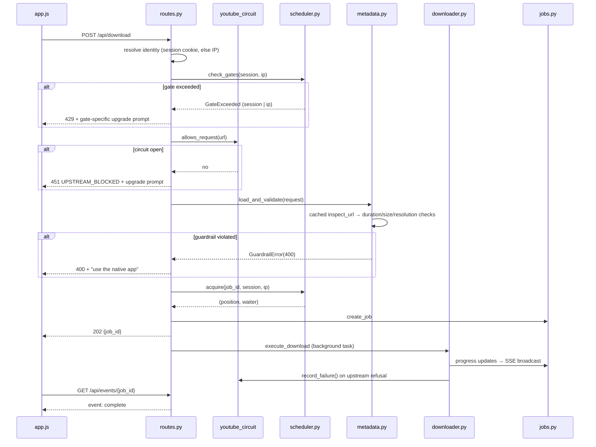
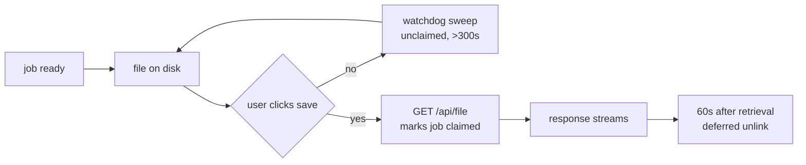

# MediaGrab — Architecture

**Version:** 3.0.0
**Status:** Living document. Describes the system **as built**, not as planned.
**Companions:** [`PRD.md`](./PRD.md) (what it is and why) · [`MULTI_PLATFORM_IMPLEMENTATION_PLAN.md`](./MULTI_PLATFORM_IMPLEMENTATION_PLAN.md) (decisions and milestones) · [`DESIGN.md`](./DESIGN.md) (visual system) · [`docs/OPERATIONS.md`](./docs/OPERATIONS.md) (deploy, release, incident runbook)

> **This file supersedes the 1.0 PWA-only architecture spec.** Version 1.0 described a
> single-mode browser app with "5-minute post-serve delete". Both are wrong now:
> the system runs in three modes, and retention is 60 seconds post-*retrieval* on
> hosted only, disabled on desktop.

---

## 1. What the system is

One FastAPI codebase, one `/api/` contract, deployed three ways:

| Mode | Where it runs | Limits | Files |
|---|---|---|---|
| **hosted** | Freestyle Linux VM (2 vCPU / 4 GB / 16 GB) | 1080p, 60 min, 1 GB, 3 concurrent | Zero retention (60 s post-retrieval) |
| **desktop** | Windows / Linux native app | Unlimited | Written to the user's Downloads folder, never deleted |
| **web** | Browser (PWA) | Same as whichever server answers | — |

The frontend is identical in all three. It learns which mode it is in from a
server-rendered `<meta name="mg-mode">` tag, not from client-side inference.

The hosted instance is published at `mediagrab.style.dev`, a free subdomain
managed by the platform (§9).

---

## 2. Principles (still load-bearing)

1. **No database.** Jobs live in memory with TTL expiry; history is `localStorage`.
2. **No frontend bundler.** Vanilla ES6, native `EventSource`, CSS custom properties.
3. **Remux-first.** `-c copy` for AVC1/AAC; trim via `download_ranges` keyframe
   slicing rather than downloading whole streams.
4. **Guardrails are server-authoritative.** Caps are computed from metadata the
   *server* fetched. Client-supplied duration or size is never trusted, so the
   caps cannot be spoofed.
5. **Desktop writes to disk; hosted streams over HTTP.** One codebase, two
   genuinely different save models (§7, §12).

---

## 3. Component map

```text
MediaGrab/
├── app/
│   ├── main.py                  FastAPI factory, lifespan, page rendering
│   ├── config.py                ALL settings; mode-dependent defaults
│   ├── api/
│   │   ├── routes.py            /info /download /progress /events /file /abort
│   │   │                        /capabilities /open-folder
│   │   │                        /diagnostics/{log,open-log,update-check}
│   │   └── schemas.py           Pydantic v2 models
│   └── services/
│       ├── extractor.py         yt-dlp metadata probe → InfoResponse
│       │                        + refusal classification (§4.1)
│       ├── downloader.py        yt-dlp + FFmpeg, progress hooks, cancellation
│       ├── jobs.py              In-memory JobManager, SSE subscriber queues
│       ├── scheduler.py         3-slot FIFO queue + session/IP gates
│       ├── metadata.py          Cached inspection + hosted guardrails
│       ├── network.py           Client IP resolution + signed session identity
│       ├── cleaner.py           Retention daemon (hosted only)
│       ├── templates.py         Server-side mg-mode injection
│       ├── downloads.py         Download targets, per-platform availability
│       ├── youtube_circuit.py   Cooldown gate for outbound YouTube requests
│       ├── ytdlp_opts.py        Shared yt-dlp options for inspect + download
│       └── logpaths.py          Launcher log + browser profile locations
├── static/                      index.html, choose.html, downloads.html, app.js
├── run_desktop.py               Launcher; window fallback chain; log binding
├── packaging/
│   ├── MediaGrab.spec           PyInstaller onedir build
│   └── fetch_ffmpeg.py          Static FFmpeg bundler
├── deploy/
│   ├── provision.sh             Idempotent VM provisioning
│   ├── push.sh                  Working tree → VM → restart → readiness probe
│   ├── mediagrab.service        systemd unit (hosted, retention on)
│   └── mg-tunnel.service        Cloudflare quick tunnel (fallback ingress only)
├── docs/OPERATIONS.md           Deploy, release, and incident runbook
├── tests/                       225 tests incl. headless-Chromium E2E
└── .github/workflows/build-desktop.yml
```

---

## 4. Request lifecycle (desktop/hosted download)



**Guardrail order matters.** The per-IP gate is checked *before* metadata
extraction, so an over-quota client is rejected without paying for a yt-dlp probe.
The circuit check sits between them: once YouTube has refused this address, the
request is refused locally without touching YouTube at all.

### 4.1 YouTube upstream posture

The hosted VM's egress address is refused by YouTube for most videos. This is
address reputation, established by measurement, not assumption:

| Attempted | Result |
|---|---|
| 11 player clients (android, ios, tv, web, mweb, …) | identical failures |
| Deno JS runtime for the player | no change |
| TLS impersonation (`curl_cffi`) | **worse** — 0/4 |
| yt-dlp nightly vs stable | 1/10 either way |
| Forced IPv6 egress | no change |
| Residential-IP control, same URLs | **succeeded** |

Nothing in the client configuration moved it, because nothing in the client
configuration was the problem.

**Response: a circuit breaker, not more requests.** See §4.2.

### 4.2 The YouTube circuit breaker

`app/services/youtube_circuit.py` allows **one** outbound YouTube request per
cooldown window (`MEDIA_GRAB_YOUTUBE_COOLDOWN_SECONDS`, default 1800 s).

```text
allowed?  ── no ──▶ 451 UPSTREAM_BLOCKED (no request leaves the server)
   │ yes
   ▼
probe YouTube
   ├── works ──▶ circuit closes; normal traffic resumes
   └── refused ──▶ circuit opens for the full cooldown; all callers get 451
```

Three properties matter:

- **Bounded exposure.** Roughly one request per window regardless of traffic,
  rather than one per visitor. This is the whole point: a retry loop against a
  refusing address is what escalates a challenge into a block.
- **Refusals are classified, not one specific string.** YouTube answers in
  several shapes — a bot check during extraction, a **403** on the media request,
  a **429** once it has decided the address is a problem. Only recognising the
  first left the breaker closed on the other two, so every retry hit YouTube
  again and the user saw the 429 the retries caused.
- **Platform-gated.** A 403 on an arbitrary host may simply mean the link is
  gone, so refusal detection only applies to YouTube URLs. Geo-restriction
  deliberately does **not** trip the breaker: it is a content decision rather
  than anti-bot, and pointing the user at the native app would be advice that
  cannot help.

**Metadata success says nothing about downloads.** The hosted instance can
extract metadata successfully while the media request is refused 403 — the
address is allowed to browse but not to download. A successful inspect is
therefore never treated as evidence that a transfer will work.

Refusals that surface mid-download report `UPSTREAM_BLOCKED` on the job, so the
client routes them to the same upgrade path as one found during inspection rather
than a generic error screen.

---

## 5. The three layers of concurrency control

This is the most subtle part of the system; see §1.1 Decision #2 of the plan.

| Layer | Default (hosted) | Keyed on | Behaviour when full |
|---|---|---|---|
| Global pool | 3 slots | — | FIFO wait, `queue_position` reported |
| Session gate | 1 | HMAC-signed session cookie | **429 immediately** |
| IP ceiling | 3 | Resolved client IP | **429 immediately** |

**Why both secondary gates?** A session cookie alone is defeated by dropping it.
The IP ceiling applies independently, so a client cannot shed its session to
acquire unlimited concurrent downloads. Setting the IP ceiling equal to the pool
size means one IP can never hold more than everything, while two strangers
behind one CGNAT NAT no longer block each other.

**The session token is not authentication.** It is an opaque random ID carrying
no user identity, no PII, and no cross-session linkage. It exists solely to make
the fairness gate sane behind shared NAT.

Two subtleties that caused real bugs, both now covered by tests:

- The gate key must be the **id half** of the token, never the signed envelope.
  Mixing the two splits one client's occupancy across two keys and silently
  disables the gate.
- The freshly-minted token gates the **first** request too, otherwise every new
  client gets one ungated download.

---

## 6. Retention lifecycle (hosted only)



Three deliberate choices:

1. **The clock starts at retrieval, not at job completion.** A user can sit on
   the ready screen indefinitely; the file is not deleted before they save it.
2. **Unclaimed files are exempt from the watchdog** regardless of mtime, so a
   slow-moving user never loses work.
3. **In-flight jobs are always skipped**, matched by the `{job_id}_` prefix
   because a running download has no `file_path` yet.

**Desktop mode disables all of this** (`RETENTION_ENABLED=false`). The output
directory *is* the user's Downloads folder; sweeping it would delete their
files. This is the single most dangerous footgun in the codebase.

Consequence: **no retention language appears in desktop UI.** The sidebar, the
history drawer and the history rows all describe desktop as "saved to your
Downloads folder", because describing a purge window that does not exist is
worse than describing nothing (§1.4 Decision #22).

---

## 7. Desktop mode specifics

### 7.1 One save destination

Desktop writes the file **server-side, straight to the user's Downloads folder**.
There is no browser download step and no second copy:

| Surface | Desktop | Hosted |
|---|---|---|
| Ready screen button | "Open in Downloads" → `POST /api/open-folder` | "Save MP4" → HTTP download, starts the purge clock |
| History row action | Reveal the folder | Download the file |
| History row copy | "saved to your Downloads folder" | "gone in <window>" |

### 7.2 Locating the Downloads folder

Two bugs made this land in the wrong place, both invisible in the source:

- **`CSIDL_PROFILE` is not the Downloads folder.** `SHGetFolderPathW` was called
  with `0x28`, which is the *profile root*; `CSIDL_DOWNLOADS` is `0x05`.
- **Import order beats environment variables.** `configure_downloads_dir()`
  resolved the target correctly, but did so by importing `app.config` — which
  executes its module-level `DOWNLOADS_DIR = Path(os.getenv(...) or ...)` and
  *caches* it. Setting `MEDIA_GRAB_DOWNLOADS_DIR` afterwards was too late, so the
  downloader and "open folder" both used the frozen bundle's `_internal/downloads`
  while the launcher reported the real folder.

The launcher now reads the override without importing `app.config`, and runs
before anything else imports it.

### 7.3 Output resolution after post-processing

Desktop is the only mode with a per-job staging directory (`.mediagrab-<id>/` via
yt-dlp's `paths.temp`), and therefore the only mode where the finished file
**moves**. Three defects once made every desktop download fail with
`Output media file was not created`:

1. The progress hook records each stream's path as it finishes — *inside* staging.
   After a merge or remux yt-dlp moves the result out, and those paths no longer
   exist.
2. The output template was `%(title).150B%(ext)s`, missing the separator, so the
   recorded path had no extension and never matched the file on disk.
3. `ydl.download()` returns an **integer retcode**, not the info dict, so it
   cannot report where the file ended up.

Resolution is now: `extract_info(download=True)` for the final location, plus
the postprocessor hook recording the path once the merge completes. Hosted hides
all of this behind a job-id glob; desktop has no such fallback.

### 7.4 Windowed (no-console) builds

The spec sets `console=False`, so PyInstaller produces a GUI-subsystem executable
whose bootloader leaves `sys.stdout`, `sys.stderr` and `sys.stdin` as `None`.

The failure mode is quiet: `print()` against a `None` stream is a **silent
no-op**, so the launcher's own status lines vanish without complaint, and the app
dies somewhere unrelated — uvicorn's `DefaultFormatter` calls `sys.stdout.isatty()`
while configuring logging and raises.

`_ensure_standard_streams()` binds the three streams to the launcher log before
`start_server()` imports uvicorn. `isatty()` then reports `False`, which is
correct for a GUI app: uvicorn disables ANSI colouring rather than emitting
escape codes nobody can see.

### 7.5 The window fallback chain

`pywebview` (WebView2) → Chromium/Edge `--app` → default browser. Two traps:

- **A private `--user-data-dir` is required, not cosmetic.** Chromium and Edge
  hand a new launch off to an already-running instance and exit immediately. If
  that happens, `proc.wait()` returns while the window is still open, and the
  launcher tears down a backend the window still needs — which presents as
  *"127.0.0.1 refused to connect"* on a demonstrably live server.
- **`--no-proxy-server` plus a bypass list.** A machine with a system proxy
  (routine in VMs and corporate images) otherwise routes `127.0.0.1` through that
  proxy, which refuses it.

The window has **no fixed timeout**. An earlier 120 s cap shut the backend down
under a window that was still open and downloading.

### 7.6 Launcher log

`app/services/logpaths.py` is the single definition of the log path, shared by
the launcher (writes) and the settings panel (reveals and copies). Two copies
would drift and the panel would open the wrong file.

- Windows: `%LOCALAPPDATA%\MediaGrab\launcher.log`
- Linux: `~/.mediagrab/MediaGrab/launcher.log` — deliberately **not** XDG, so an
  existing log is not orphaned
- macOS: `~/Library/Application Support/MediaGrab/launcher.log`

The launcher also wraps the server thread: an exception there is printed by the
threading machinery to a discarded stream and the thread simply dies, so it is
caught and logged explicitly. A watchdog logs reachability transitions while the
window is open, which separates a dead backend from a window that cannot route
loopback.

---

## 8. Frontend mode resolution


Mode comes from the **meta tag**, not the fetch. `/api/capabilities` can 404
when `sw.js` serves a newer `app.js` against an older backend; the meta tag
cannot race and always reflects the running server.

Controls that cannot act are **hidden, not disabled** (§1.4 Decision #23). The
settings trigger, the diagnostics group and the update group all ship `hidden` in
the markup and are revealed only after the mode is known, so they never flash on
the public site before the mode is resolved.

---

## 9. Public exposure

The VM has **no public IP**, so the app needs an ingress path.

**Preferred — a `*.style.dev` subdomain.** Free, permanent, with a
platform-managed wildcard certificate; no DNS records, no verification, and no
tunnel process to keep alive:

```bash
npx freestyle@latest tls create --domain mediagrab.style.dev \
  --from public --to vm=<vm-id>,port=8000
```

The service must listen on `0.0.0.0`; `deploy/mediagrab.service` already does.

**Fallback — a Cloudflare quick tunnel.** No account needed, but the hostname is
**random and changes on every restart**, breaking any shared link. Local
debugging only.

### 9.1 `BEHIND_PROXY` behind an ingress edge

Behind any ingress edge every visitor shares the edge's socket address. With
`BEHIND_PROXY=false`, client-IP resolution returns the socket peer, which
collapses the per-IP concurrency limit into a **global** one. It therefore ships
`true` in the provisioner and on the running instance.

It only appeared to work before, because `uvicorn --proxy-headers` rewrites
`request.client.host` from `X-Forwarded-For` behind the application's back. That
is accidental correctness and was measured, not assumed: six concurrent requests
with six distinct forwarded addresses still capped at three, and four with an
identical address still produced exactly one `429`.

---

## 10. Build & release

**Desktop** — PyInstaller *onedir*: a `.exe` beside a large `_internal/` folder.
The `.exe` alone **will not run**; releases ship a zip of the whole bundle.

### 10.1 Packaging traps, all hit in practice

- `yt_dlp` imports ~1,000 site extractors dynamically. `collect_all("yt_dlp")` is
  required or every site fails at runtime.
- `pythonnet` and `clr_loader` are imported dynamically by `pywebview`, so
  PyInstaller cannot see them. Uncollected, the native window fails to resolve
  `Python.Runtime.Loader.Initialize` on every run and silently degrades.
- The **version** is stamped from the tag at package time. An update check is
  meaningless without knowing what is running.

### 10.2 The pipeline is gated on verification

```text
windows ──┐
          ├──▶ publish (needs both) ──▶ GitHub Release
linux   ──┘
```

Build jobs upload artifacts only. A single `publish` job with
`needs: [windows, linux]` creates the release, and refuses to publish if any
expected asset is missing. This exists because v0.1.0 published a **Linux-only
release**: each build job created the release itself, so the Linux job shipped
while the Windows job failed. Unverified builds are now never published.

### 10.3 Three smoke tests, because startup is not enough

| Test | Catches |
|---|---|
| Backend starts (piped) | Import/boot failures |
| **No-console launch** (no redirection) | The windowed-stdio crash. A launch *with* redirection hands the child real handles, so `sys.stdout` is never `None` and the bug cannot appear |
| **A real download** | Everything in §7.3. Served from a committed 17 KB fixture over a local HTTP server — an earlier version used YouTube and failed because CI addresses trip the same bot check |

---

## 11. Testing

225 tests, green in both modes:

```bash
uv run pytest -q                              # desktop
MEDIAGRAB_MODE=hosted uv run pytest -q         # hosted
```

Notable: `tests/e2e_hosted_ui.mjs` and `tests/e2e_youtube_upsell.mjs` drive real
headless Chromium over CDP against both a hosted and a desktop server, covering
quality gating, the 429 path, the retention countdown, the post-save notice
states, and the YouTube upsell. `/api/download` and `/api/events` are
intercepted so no real media is fetched.

---

## 12. Security posture

| Concern | Handling |
|---|---|
| Spoofed `X-Forwarded-For` | Trusted when `BEHIND_PROXY=true`, which is required behind the ingress edge. The VM has no public IP, so only the edge can reach it — but the header is honoured from any source and should be narrowed to the edge's CIDRs once published |
| Session forgery | HMAC-SHA256, `hmac.compare_digest`, 128-bit random IDs |
| Session cookie theft | `HttpOnly`, `SameSite=Lax`, `Secure` on HTTPS |
| Size-cap evasion | Pre-flight estimate is server-computed; `--max-filesize` is only a coarse backstop |
| Downloaded code | FFmpeg is **GPL-3.0** (BtbN), not covered by the repo's MIT licence |
| Secrets | `SESSION_SECRET` read from env; never committed. `.env` is gitignored. |
| Diagnostic endpoints | `/api/diagnostics/*` are desktop-only and answer `404` on hosted |

**`BEHIND_PROXY` is the highest-risk setting.** It must be true behind an ingress
edge, and any client able to reach the app directly can then forge its IP and
weaken both gates.

---

## 13. Known failure modes

Each of these shipped at least once and cost a release. None is obvious from
reading the code, which is why they are written down.

| Symptom | Root cause | Where it lives |
|---|---|---|
| Windows app dies before opening a window | GUI-subsystem build leaves `sys.stdout` as `None`; uvicorn's logging calls `.isatty()` | §7.4 |
| Window shows *"127.0.0.1 refused to connect"* on a live backend | Browser handed off to a running instance and exited; launcher read that as "window closed" | §7.5 |
| Same message, proxy present | System proxy applied to loopback by the browser | §7.5 |
| *"Output media file was not created"* (desktop only) | Post-processed file moves out of staging; recorded paths are stale. Masked on hosted by a glob | §7.3 |
| Every hosted download fails with an int/str `TypeError` | `--max-filesize` passed as `"1024m"`; yt-dlp compares it numerically | `config.py` |
| Downloads land inside `_internal/` | `CSIDL_PROFILE` (0x28) instead of `CSIDL_DOWNLOADS` (0x05), plus an import-order cache | §7.2 |
| Files named `…Filmmp4` | Missing separator in the output template | §7.3 |
| Windows build reports version `dev` forever | `${GITHUB_REF_NAME}` is unset in PowerShell; needs `shell: bash` | §10.1 |
| "Too many requests" from YouTube | Breaker recognised only the bot check, so 403/429 left it closed and retries kept asking | §4.2 |
| Every error mislabelled *"MEDIA_INACCESSIBLE"* | Diagnosis code was hardcoded in markup and never written by any code path | `static/choose.html` |
| Icons rendering ~230 px wide | `.ico` declared stroke but no `width`/`height`, so the SVG filled its container | `static/css/app.css` |
| `push.sh` silently failing | Piped `tar -f -` is not forwarded through the CLI; provisioning also `apt`-installed as non-root | `deploy/push.sh` |

---

## 14. Known limitations

- **No installer.** Zip/tarball extraction only. No `.exe` installer, AppImage,
  `.desktop` entry, or Start Menu shortcut.
- **No auto-update.** The settings panel detects a newer release and links to it;
  nothing replaces the running build.
- **Android is not built.** The download button says so rather than pointing at an
  asset that does not exist (`DOWNLOADS_PUBLISHED` gates this per platform).
- **Hosted YouTube downloads are mostly refused.** §4.1, §4.2. The native apps
  are unaffected because they download from the user's own connection.
- **`pywebview` needs a matching PyGObject/.NET stack.** Often mismatched in a
  frozen build; the chain falls back to an app-mode browser window.
- **Cancellation is cooperative.** yt-dlp runs in a thread executor and cannot be
  hard-killed; abort sets an event polled at the next hook tick.
- **Session-first rate limiting is unexercised in real multi-user conditions.**
  Tests prove semantics; nothing proves behaviour under actual NAT traffic.
- **The VM is deleted after 30 days of continuous idleness**, not merely paused.
  Regular traffic resets it. See `docs/OPERATIONS.md`.