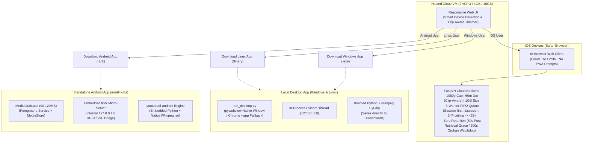
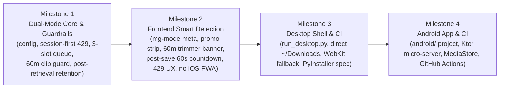

# MediaGrab — Multi-Platform Architecture & Implementation Plan
**Document:** `MULTI_PLATFORM_IMPLEMENTATION_PLAN.md`  
**Status:** Approved & Cleared via Ambiguity Gate
**Amendments:** §1.1 (Milestone 1 review — session-first identity, Android size budget) · §1.2 (Milestone 2 gate — capability sourcing, countdown semantics, locked resolutions).  
**Purpose:** Technical specification, architecture blueprint, and phased execution roadmap for MediaGrab across three platforms:
1. **1-Click Native Desktop App** (Windows & Linux) — Full on-device unlimited capabilities.
2. **Hosted Cloud Instance** (2 vCPU / 4GB RAM / 16GB Disk VM) — Resource-guarded Cloud Lite instance with zero file retention and smart native download promotions.
3. **Standalone On-Device Android App** (`.apk`) — Direct mobile engine (90–120MB APK, ~250–350MB installed) with server-unlimited downloads directly to phone storage.
*(Note: iOS is served strictly as a standard in-browser web client under Cloud Lite rules with zero PWA install prompts).*

---

## 1. Ambiguity Gate Clearance & Decision Record

The following architectural decisions were formally evaluated and confirmed during the Ambiguity Gate audit:

| # | Architecture Dimension | Selected Strategy | Technical Rationale |
|---|---|---|---|
| **1** | **Android API Bridging** | **Embedded Ktor Micro-Server in Kotlin (`127.0.0.1:0`)** | Preserves 100% unified `/api/` fetch and SSE contracts in `app.js` across Web, Desktop, and Android without branching frontend logic. |
| **2** | **Session-First Rate Limiting** | **HTTP 429 — session gate (1) + IP ceiling (3) [Implemented]** | Immediately rejects duplicate concurrent download attempts with an upgrade prompt. Identity resolves to a signed session cookie when present, falling back to IP, so users behind a shared CGNAT NAT no longer block each other. |
| **3** | **Zero-Retention Lifecycle** | **60-Second Post-Retrieval Grace Window** | Protects against browser range requests (`Range: bytes=0-0`), multi-part downloads, and stream reconnects before unlinking. The clock starts at the first `GET /api/file`, not at job completion, so a file on the ready screen is never swept early. Orphan watchdog is 300s. |
| **4** | **Desktop Save Paradigm** | **Direct to `~/Downloads` + App-Mode Fallback** | Local app writes directly to `~/Downloads` with *"Saved to Downloads"* UI. If WebKitGTK is missing on Linux, falls back to Chrome/Chromium `--app` mode. |
| **5** | **CI/CD & Toolchain Strategy** | **GitHub Actions Cloud Builds for Android & Windows** | Android APK (`arm64-v8a`) and Windows `.exe` are compiled on GitHub Actions runners. Local Linux development verified with Python and `uv`. |
| **6** | **Job Cancellation** | **Cooperative cancellation via progress-hook flag** | yt-dlp executes inside a thread executor and cannot be hard-killed. Abort sets a shared `threading.Event` polled by the download and postprocessor hooks; partials are purged on the next hook tick. A true `SIGKILL` requires migrating yt-dlp to a subprocess — tracked as future work. |
| **7** | **Android APK Size Budget** | **90–120 MB APK / ~250–350 MB installed (Revised, see §1.1)** | Supersedes the original ~42 MB estimate. The `youtubedl-android` AAR alone is 56.5 MB before FFmpeg, and native libraries install uncompressed. |

### 1.1 Amendments (Milestone 1 Review)

**Decision #2 revised — session-first identity resolution. [IMPLEMENTED]** The original per-IP-only design was correct in intent but produced unacceptable real-world behavior: consumer and enterprise carriers place many subscribers behind a single CGNAT NAT address, so two unrelated users on the same egress IP would permanently 429 each other even with all 3 slots idle. Resolution now runs:

1. If a valid, HMAC-signed session cookie is present → use the session ID as the identity key.
2. Otherwise → mint a session and fall back to IP for this request.

The IP remains a **secondary** constraint so a client cannot trivially bypass the gate by simply dropping cookies: the per-IP ceiling applies independently and is set to the global concurrency limit, meaning one IP can never occupy more than all 3 slots. The cookie is a fairness mechanism, not an authentication mechanism — it carries no user identity, is server-issued, `HttpOnly` + `SameSite=Lax`, and is only used to disambiguate concurrent-download fairness.

Implementation notes:
- Tokens are `<random-id>.<HMAC-SHA256>`; signatures are compared with `hmac.compare_digest` so a valid signature cannot be recovered by timing. A forged or malformed cookie is discarded and a new session issued.
- The gate key is always the **id half**, never the signed envelope. Mixing the two forms splits one client's occupancy across two gate entries and silently disables the session gate — this was a real defect caught during testing.
- The freshly-minted token gates the *first* request too, otherwise every new client would receive one ungated download before the cookie existed.
- `SESSION_SECRET` is HMAC-keyed. When unset, a per-process key is generated and a warning is logged; sessions then reset on restart, which is acceptable for a fairness device and preferable to a hardcoded key.
- Desktop mode issues no cookie: it is per-user and uncapped, so a cookie would be pointless state.

**Decision #7 added — Android size budget corrected.** The ~42 MB figure was not achievable. The `youtubedl-android:library` AAR is 56.5 MB and the FFmpeg AAR adds further weight; only `arm64-v8a` is shipped, and native libraries install uncompressed to disk. Budget **90–120 MB APK, ~250–350 MB installed**. Release notes and the store listing must state this honestly rather than promising a 42 MB download.

**Additional M1 findings folded into the spec:**
- `--max-filesize 1024m` is a **coarse backstop only**, not an authoritative size guard. yt-dlp evaluates it per stream, so a merged `bestvideo+bestaudio` output can exceed the cap. The pre-flight estimate in `metadata.validate_request` is the real enforcement; the flag remains as defense in depth.
- The Android WebView cannot load `http://127.0.0.1:{port}/` without a `networkSecurityConfig` permitting cleartext to loopback, and Ktor must serve the bundled `static/` assets in addition to the `/api/` bridge. Both were omitted from the original Component 4 spec and are now specified in §4 Component 4.

### 1.2 Milestone 2 Gate (Frontend)

M2 could not proceed as written: its spec directly contradicted §1.1 Decision #3, and the existing frontend hardcoded the opposite of both. Resolutions below.

**Decision #8 — countdown starts at save click.** §4 and §5 M2 originally specified a "60-second countdown on ready screen" with the notice *"deleted from the server 60 seconds after download."* That predates Decision #3, which moved the grace clock to the first `GET /api/file`. A countdown started at job-ready measures the wrong interval — the file is still alive when it reaches zero. The live countdown now begins **only after the user clicks save**, mirroring the actual purge trigger. The ready screen shows a static, honest notice with no timer.

**Decision #9 — mode from a server-rendered meta tag; limits fail-safe.** `/api/capabilities` is same-origin, served by the same FastAPI app as the page itself, so a hard failure implies the page failed too. The realistic failure is **stale-new/old-backend skew**: `sw.js` can serve a newer `app.js` against a server predating the endpoint, yielding a persistent `404`. Therefore:
  * The server injects `<meta name="mg-mode" content="hosted|desktop">` into `index.html` / `choose.html` at serve time — same origin, zero latency, and structurally incapable of racing the fetch.
  * `/api/capabilities` supplies only numeric limits and download URLs.
  * If that fetch fails or 404s, the UI degrades to **hosted-safe defaults** (max 1080p, no promo strip, no countdown) but the page remains fully usable and the Grab button is never blocked.
  * Cost accepted: a desktop user with a broken capabilities fetch sees chips conservatively gated. This is safe, recoverable, and strictly better than the reverse — in desktop mode the backend applies no guardrails, so failing open would misrepresent capability while failing closed merely mislabels it. On hosted, a transient failure would otherwise advertise 4K that immediately 400s.

**Decision #10 — locked resolutions are disabled, badged, and self-correcting.** `/api/info` returns all resolutions the source offers, including above the hosted cap, since the extractor is mode-unaware. In hosted mode chips above the cap render **disabled with a "Desktop/Android only" badge** — preserving the upsell surface the promo strip leads toward rather than hiding it. If a stored or incoming quality preference is itself locked, the UI **automatically selects the highest permitted option**. Hiding locked resolutions was rejected because it removes the conversion surface; leaving a stale locked selection to 400 server-side was rejected as poor UX.

**Decision #11 — 429 is a first-class UI state.** Post-M1, `429` is a designed outcome carrying a gate-specific message (§4). `app.js` currently collapses every non-OK response into a generic error ("Subtitles unavailable."). The frontend must branch on `429` specifically and surface the server's upgrade prompt verbatim, rather than flattening a conversion opportunity into a dead end.

**Carried-forward observation (resolved):** the ready screen used to call `startDeletionCountdown(30 * 60)` and render *"Deleted from this machine in 29:59."* Wrong in hosted mode (duration, referent, start point) and wrong for desktop, where retention is indefinite. Replaced by Decision #8.

### 1.3 Milestone 3 Gate (Desktop Shell)

M3's "save directly to `~/Downloads`" requirement collides with retention code that is already shipped. Resolutions below.

**Decision #12 — retention is disabled in desktop mode.** The cleaner daemon starts unconditionally in the FastAPI lifespan and sweeps `DOWNLOADS_DIR`, unlinking anything older than `ORPHAN_MAX_AGE_SECONDS` (1800s on desktop). Redirecting `DOWNLOADS_DIR` to `~/Downloads` would therefore have **deleted the user's files after ~30 minutes**. Desktop mode now bypasses the cleaner daemon entirely, and the deferred/purge paths become no-ops. Hosted retention is unchanged.

**Decision #13 — user-facing filenames, with numeric dedupe.** The existing output template is `{job_id}_%(title).%(ext)s`, which would surface as `a19bd4ff_Never Gonna Give You Up.mp4` in the user's Downloads folder. Desktop output uses the bare title; on collision yt-dlp appends ` (1)`, ` (2)`, matching browser download behaviour. The job-id prefix remains in hosted mode, where filenames are ephemeral and never seen twice.

**Decision #14 — desktop suppresses the browser save.** With a server-side write, the frontend must not also navigate to `/api/file/{job_id}`, or the file is written twice. Desktop mode branches on the existing `mg-mode` tag: no navigation, and the ready screen shows *"Saved to Downloads"* with an **Open in Folder** action. Hosted keeps its current browser-driven save.

**Verification scope:** the Windows `.exe` cannot be executed from the Linux build host, so M3 is verified on Linux only. The PyInstaller spec and GitHub Actions workflow are delivered unproven; the maintainer has a Windows VM and verifies manually. No claim of Windows correctness is made without that run.

---

## 2. Ecosystem Architecture

---

## 3. Platform Comparison Matrix

| Dimension | Hosted Cloud Instance | Local Desktop App | Standalone Android APK | iOS Web Users |
|---|---|---|---|---|
| **Target Platforms** | Shared Cloud VM (2 vCPU / 4GB / 16GB) | Windows (.exe) & Linux (Binary) | Android 8.0+ (.apk) | iOS Safari Browser |
| **Execution Engine** | Cloud VM CPU & RAM | User's PC CPU & GPU | User's Phone ARM Processor | Cloud VM CPU & RAM |
| **Max Video Resolution** | **1080p** (2160p & 1440p locked) | **Unlimited** (4K / 8K / 60fps) | **Unlimited** (1080p remux recommended) | **1080p** |
| **Max Duration** | **60 minutes** (Clip-aware; SRT exempt) | **Unlimited** | **Unlimited** | **60 minutes** (Clip-aware; SRT exempt) |
| **Max File Size** | **1.0 GB** (Pre-flight estimation + 1024m guard) | **Unlimited** | **Unlimited** (Phone storage) | **1.0 GB** |
| **Concurrency** | **3 active jobs** (Session-first: 1 per session, 3 per IP ceiling) | **Concurrent** | **Concurrent / Queued** | Shares hosted 3-worker pool |
| **File Storage** | **Zero retention**: purged 60s after first retrieval, tab close (`POST /api/abort`), or 300s orphan sweep | Saved permanently to `~/Downloads` | Saved directly to `/Download` via Android `MediaStore` | Downloaded to Files app; purged on VM |
| **PWA Install Prompts** | Disabled across hosted web (redirects to native app) | N/A | N/A | **Completely disabled** |
| **Distribution** | Hosted VM URL | GitHub Releases (`.exe` / `.tar.gz`) | GitHub Releases & Hosted Site (`.apk`) | Web browser URL |

---

## 4. Detailed Component Architecture

### Component 1: Cloud Backend & Guardrails (`app/`)

#### Configuration (`app/config.py`):
* `MEDIAGRAB_MODE = os.getenv("MEDIAGRAB_MODE", "desktop").lower()` (`"desktop"` or `"hosted"`).
* `BEHIND_PROXY = os.getenv("BEHIND_PROXY", "false").lower() == "true"` (Controls trusted header resolution for real IP extraction).
* Hosted limits:
  * `HOSTED_MAX_RESOLUTION = "1080p"`
  * `HOSTED_MAX_DURATION_SECONDS = 3600` (60 minutes; SRT mode exempt)
  * `HOSTED_MAX_FILE_SIZE_BYTES = 1 * 1024 * 1024 * 1024` (1 GB)
  * `HOSTED_CONCURRENCY = 3` (Global Semaphore)
  * `HOSTED_PER_IP_CONCURRENCY = 3` (Secondary ceiling — one IP can never hold more than the full pool; see §1.1)
  * `HOSTED_PER_SESSION_CONCURRENCY = 1` (Primary gate — the limit users actually feel)
  * `SESSION_COOKIE_NAME = "mg_session"`
  * `SESSION_SECRET` (env; auto-generated at startup with a warning if unset)
  * `HOSTED_POST_DOWNLOAD_GRACE_SECONDS = 60` (Post-retrieval; protects browser range requests/retries)
  * `HOSTED_IDLE_WATCHDOG_SECONDS = 300` (Orphan sweep; must exceed the grace window)
  * `GITHUB_RELEASES_URL = "https://github.com/ZenDevvv/MediaGrab/releases/latest"` (real repo, not a placeholder)
  * `MEDIAGRAB_MODE = os.getenv("MEDIAGRAB_MODE", "desktop")` — the hosted Docker image sets `hosted`.

#### Real IP Resolution (`app/services/network.py` or helper in `app/api/`):
* If `BEHIND_PROXY` is enabled:
  1. Inspect `CF-Connecting-IP` (Cloudflare).
  2. Inspect first address in `X-Forwarded-For`.
  3. Fall back to `request.client.host`.
* If `BEHIND_PROXY` is disabled, strictly use `request.client.host`.

> **Security requirement.** Forwarded headers must never be trusted when the
> origin is directly reachable — otherwise any client forges an address and
> defeats both gates. `BEHIND_PROXY` gates this explicitly and defaults to
> `false`.

#### Session-First Identity Resolution (`app/services/network.py`):
* **Rationale (§1.1):** per-IP-only limiting punishes unrelated users sharing a
  CGNAT NAT. A server-issued session cookie disambiguates them without
  introducing accounts.
* Resolution order for every `/api/download`:
  1. Valid signed session cookie present → identity = session ID.
  2. Otherwise → identity = resolved client IP (per the rules above).
* **Both gates always apply.** The session gate is the tight one (1 active
  download); the IP gate is the anti-evasion ceiling (3 active downloads). A
  client dropping its cookie to reset the session gate still cannot exceed the
  IP ceiling, so the pool cannot be monopolized.
* Session cookies are:
  * server-issued on first `/api/download`, returned via `Set-Cookie`;
  * `HttpOnly` (not readable by JS), `SameSite=Lax`, `Secure` when served over
    HTTPS, `Path=/`;
  * an opaque random identifier (≥128 bits entropy) — **no user identity, no
    PII, no cross-session linkage.** This is a fairness device, not auth;
  * rejected (and regenerated) if the signature does not verify.
* Signing uses an HMAC keyed by `SESSION_SECRET`. If `SESSION_SECRET` is
  unset, the server generates one at startup and logs a warning — sessions then
  reset on restart, which is acceptable for fairness purposes.
* **A 429 response must distinguish which gate tripped** so the UI can show an
  accurate message: a session-limit 429 and an IP-limit 429 read differently.
  The session message is the one quoted in §4 Component 1.

#### Schemas (`app/api/schemas.py`):
* `CapabilitiesResponse`:
  * `mode`: `"desktop"` | `"hosted"`
  * `limits`: Dictionary with `max_resolution`, `max_duration_seconds`, `max_file_size_bytes`, `concurrency_limit`, `per_ip_limit`, `per_session_limit`, `idle_watchdog_seconds`, `locked_resolutions`.
  * `retention_seconds`: post-retrieval grace window (60 hosted / 1800 desktop).
  * `downloads`: Dictionary with `windows_url`, `linux_url`, `android_url`.
* `JobProgressResponse`: includes `queue_position: Optional[int]`, `active_slots: int`.

#### Downloader Service & Guardrails (`app/services/downloader.py` & `app/api/routes.py`):
* **Unqueued Extraction**: `/api/info` remains immediate and outside the download queue. Its result seeds the short-lived metadata cache so `/api/download` can enforce guardrails without a second extraction. (No `/api/extract` endpoint exists — the plan's original mention was removed in M1.)
* **Fair-Share 3-Slot Concurrency Gate**:
  * Global `asyncio.Semaphore(3)`.
  * Session gate: max 1 active download per session ID (falls back to IP when no cookie — see §4 "Session-First Identity Resolution").
  * IP ceiling: max 3 active downloads per resolved IP, applied independently so cookie-dropping cannot evade the gate.
  * If either gate is exceeded: return **HTTP 429 Too Many Requests** with a detail message that names the gate which tripped:
    > *Session gate:* "Only 1 concurrent download allowed per session on hosted server. Please wait for your previous download to finish, or download the desktop/Android app for unlimited concurrency."
    > *IP ceiling:* "Too many concurrent downloads from your network. Please wait for an active download to finish, or download the desktop/Android app for unlimited concurrency."
  * Jobs beyond 3 active slots enter FIFO wait; progress updates stream `"Server busy (3/3 slots). Waiting in queue (Position X)..."`.
* **Clip-Aware Validation**:
  * Mode `srt` is **exempt** from the 60-minute duration cap.
  * If source video duration $\le 60\text{m}$, allowed directly.
  * If source video duration $> 60\text{m}$, extraction succeeds, but `/api/download` validates that trimmed clip duration $(end - start) \le 3600\text{s}$. If untrimmed, returns HTTP 400 guiding the user to trim a segment or download the native app.
* **Pre-Flight Size Estimation & In-Flight Guard**:
  * Evaluates metadata `filesize`, `filesize_approx`, or `tbr * duration`. If estimated size $> 1.0\text{ GB}$, rejects upfront with HTTP 400.
  * Passes `--max-filesize 1024m` to `yt-dlp` as **coarse defense in depth**. Note (§1.1): yt-dlp evaluates this per stream, so a merged `bestvideo+bestaudio` output can still exceed the cap — the pre-flight estimate is the authoritative enforcement, not this flag.
  * A size estimate of *unknown* must **not** be treated as either passing or failing. Unknown passes pre-flight and defers to the in-flight guard.
  * Catches yt-dlp `DownloadError` and returns a clean, user-friendly error message, mapping max-filesize failures to an explicit "download the native app" prompt.
* **Zero-Retention File Engine**:
  * `GET /api/file/{job_id}` schedules deferred removal with `delay_seconds=60` via FastAPI `BackgroundTasks`. **The countdown starts on first retrieval, not on job completion** — a file sitting on the ready screen is never deleted before the user clicks Save.
  * Marking a job `claimed` on that first retrieval hands the file to the orphan watchdog; unclaimed ready files are exempt from the watchdog regardless of mtime.
  * `POST /api/abort/{job_id}` requests cooperative cancellation (§1 Decision #6) and purges partial artifacts.
  * Background cleaner daemon unlinks any unclaimed, unclaimed-by-any-live-job file older than `ORPHAN_MAX_AGE_SECONDS` (300s hosted). Files belonging to in-flight jobs — matched by the `{job_id}_` prefix, since a running download has no `file_path` yet — are always skipped.

---

### Component 2: Frontend UX & Smart Device Detection (`static/`)

#### Smart Device Detection (`static/js/app.js`):
* Mode is read from the server-rendered `mg-mode` meta tag (authoritative, race-free — §1.2 Decision #9). Numeric limits and download URLs come from `GET /api/capabilities`, degrading to hosted-safe defaults on failure.
* Inspects `navigator.userAgent` and `navigator.maxTouchPoints`:
  * **Windows**: Shows *"Get 4K & Unlimited Downloads → [Download Windows App (.exe)]"*.
  * **Linux**: Shows *"Get 4K & Unlimited Downloads → [Download Linux App]"*.
  * **Android**: Shows *"Download directly on your phone → [Download Android App (.apk)]"*.
  * **iOS**: Suppresses all PWA prompts; displays standard Cloud Lite notice with zero install popups.
* **PWA Suppression**: Cancels generic `beforeinstallprompt` on hosted web to prevent confusion with native apps.

#### UI Modifications (`static/index.html` & `static/choose.html`):
* **Top Promo Strip (`#hosted-promo-strip`)**: Sleek banner with platform-targeted download CTA. Includes an "Other Platforms" toggle to view all downloads.
* **Feature Gating**: 1440p and 2160p resolution chips render **disabled with a "Desktop/Android only" badge** in hosted mode — the chips stay visible to preserve the upsell surface. If a stored or incoming quality preference is itself locked, the UI **auto-selects the highest permitted option** (§1.2 Decision #10).
* **Clip-Aware Trimmer UI**:
  * When source video $> 60\text{m}$ and mode is `mp4` or `mp3`, display banner on `/choose`:
    > *"Hosted limit: 60 minutes. Trim a segment $\le$ 60 minutes below, or download the Desktop/Android app for full videos."*
  * The "Grab" button remains disabled until the selected trim range is $\le 60\text{m}$.
  * Mode `srt` shows no trimmer warning and allows grabbing full transcripts.
* **Ready Screen Notice**:
  * In **Hosted Mode**: A static, honest notice with **no countdown**:
    > *"⚠️ Ephemeral Server: This file is deleted from the server shortly after you save it."*
    The live 60-second countdown begins **only when the user clicks save**, mirroring the actual `GET /api/file` purge trigger (§1.2 Decision #8). A countdown shown on the ready screen would reach zero while the file is still alive.
  * In **Desktop Mode**: Displays *"✅ Saved to Downloads"* with an *"Open in Folder"* action, and **no retention timer** — files persist.

---

### Component 3: Local Desktop Shell (`run_desktop.py` & Packaging)

#### Desktop Runner (`run_desktop.py`):
* Binds FastAPI to an ephemeral local port (`127.0.0.1:0`).
* Starts Uvicorn in a daemon thread with `MEDIAGRAB_MODE=desktop`.
* Configures default output directly to user's OS Downloads folder (`Path.home() / "Downloads"`).
* Prepends bundled static FFmpeg directory to `PATH`.
* Spawns native `pywebview` window (Edge WebView2 on Windows, WebKitGTK on Linux).
* **Headless / Missing WebKitGTK Fallback**:
  * If `WebKitGTK` or `pywebview` fails to launch on Linux, automatically detects and spawns Chrome/Chromium in app mode:
    `google-chrome --app=http://127.0.0.1:{port}` / `chromium --app=http://127.0.0.1:{port}`.
  * If no Chromium browser exists, falls back to `webbrowser.open()`.
* Shuts down cleanly on window close.

#### PyInstaller Spec (`packaging/MediaGrab.spec`):
* Bundles Python backend, static assets, and FFmpeg binary into standalone distributions.
* Configures PyInstaller `--onedir` / `--onefile` profiles.

#### GitHub Actions CI (`.github/workflows/build-desktop.yml`):
* Automates Windows `.exe` and Linux binary compilation on git tag releases.

---

### Component 4: Standalone Android App (`android/`)

#### Architecture:
* Located in monorepo directory `android/`.
* **Embedded Ktor Micro-Server**:
  * Spins up an internal Ktor HTTP server on `127.0.0.1:0` in a background coroutine.
  * Exposes identical `/api/info`, `/api/download`, `/api/progress/{job_id}`, and `/api/events/{job_id}` endpoints.
  * Frontend WebView navigates to `http://127.0.0.1:{port}/`, executing unchanged `app.js` logic.
  * **Must also serve the bundled web assets** (`/css`, `/js`, `/icons`, `/`, `/choose`) from the APK's assets directory. The original spec described only the `/api/` bridge, which would leave the WebView with no UI to load.
  * Use the **CIO engine** (`ktor-server-cio`) rather than Netty — CIO is coroutine-based with a much smaller dependency footprint, which matters directly against the size budget in §1.1.
* **Cleartext Loopback Configuration (mandatory)**:
  * Android blocks cleartext HTTP by default on API 28+. The WebView loading `http://127.0.0.1:{port}/` will silently fail without an explicit exception.
  * Ship a `res/xml/network_security_config.xml` scoped **only** to loopback domains (`127.0.0.1`, `localhost`, `::1`) with `cleartextTrafficPermitted="true"`, referenced from the manifest via `android:networkSecurityConfig`.
  * The base config must keep cleartext **disabled** for all other domains — do not set a blanket `usesCleartextTraffic="true"`.
  * Note: from Android 17 (API 37) an implicit localhost config exists, but we still ship the explicit config for the 8.0–16 range.
* **Core Engine**:
  * Integrates `youtubedl-android` (`io.github.junkfood02.youtubedl-android`, latest stable 0.18.x).
  * Initialize both `YoutubeDL.getInstance().init(this)` **and** `FFmpeg.getInstance().init(this)` — without FFmpeg, remux/mp3/subtitle postprocessing silently fails.
  * Pre-compiled FFmpeg shared libraries (`.so`) for `arm64-v8a` ABI only.
  * **Size budget: 90–120 MB APK, ~250–350 MB installed** (§1.1, Decision #7). This is the honest figure and must be stated in release notes and any store listing. Supersedes the original ~42 MB / ~85 MB estimates throughout this document.
* **Storage & Services**:
  * Foreground Service with persistent notification to prevent Android OS process kills during active downloads.
  * Completed media moved to `/Download` folder via Android `MediaStore.Downloads` (API 29+) with legacy storage fallback for API 26–28.
  * Silent background `yt-dlp` updates via `YoutubeDL.getInstance().updateYoutubeDL()`.
  * **License obligation:** `youtubedl-android` is GPL-3.0. The distributed APK must comply with GPL-3.0 (source availability + license notice). Confirm before publishing any binary.

#### GitHub Actions CI (`.github/workflows/build-android.yml`):
* Sets up JDK 17 (Temurin) and the Android SDK via `android-actions/setup-android@v4`.
* Compiles `MediaGrab-arm64-v8a.apk` (**budget 90–120 MB**) and attaches it to GitHub Releases.
* Signing keys are supplied from GitHub Secrets (base64-encoded keystore); the keystore must never be committed to the repository.

---

## 5. Implementation Milestones

### Milestone 1: Dual-Mode Backend Core & Guardrails (`app/`)
1. Implement `MEDIAGRAB_MODE`, `BEHIND_PROXY`, and hosted limit constants in `app/config.py`.
2. Implement real IP extraction helper in `app/services/network.py`.
3. ~~Implement session-first identity resolution~~ **[DONE]** HMAC-signed opaque session cookie, session gate (1) + independent IP ceiling (3), both always enforced (§1.1).
4. Add `GET /api/capabilities` returning mode, limits, retention, and release URLs.
5. Implement 3-slot FIFO Semaphore with the dual session/IP gate (HTTP 429, gate-distinguishing detail messages).
6. Implement server-side metadata cache and clip-aware duration validator ($\le 60\text{m}$ trimmed segment allowed; SRT exempt).
7. Implement pre-flight size estimator (unknown = pass-through) and `--max-filesize 1024m` coarse backstop with clean error handling.
8. Implement post-retrieval deferred cleanup, orphan watchdog with in-flight/ready-file exemptions, and `POST /api/abort/{job_id}`.
9. Add automated test suite in `tests/test_capabilities_and_modes.py`.

### Milestone 2: Frontend UX & Smart Detection (`static/`)
1. Server renders `mg-mode` meta tag into `index.html` / `choose.html` at serve time (§1.2 Decision #9).
2. Add capability fetching for numeric limits and download URLs, degrading to hosted-safe defaults on failure — never blocking the Grab button.
3. Add dynamic promo strip (`#hosted-promo-strip`) with OS-tailored CTA and "Other Platforms" switcher.
4. Gate >1080p resolution chips in hosted mode: disabled + "Desktop/Android only" badge, with automatic downgrade of a stale locked preference (§1.2 Decision #10).
5. Implement clip-aware trimmer warning banner and Grab-button validation on `/choose` (hosted mode only).
6. Replace the hardcoded ready-screen countdown with a static notice; start the live 60s countdown only on save click (§1.2 Decision #8).
7. Branch on HTTP `429` to surface the server's gate-specific upgrade prompt verbatim (§1.2 Decision #11).
8. Suppress generic PWA prompts across hosted mode; ensure iOS Safari is clean.
9. Update Playwright/DOM tests in `tests/test_ui_dom.py`.

### Milestone 3: Desktop App Shell & Packaging
1. Build `run_desktop.py` with port discovery, direct `~/Downloads` target, and WebKitGTK / Chrome `--app` fallback.
2. Build PyInstaller spec file in `packaging/MediaGrab.spec`.
3. Create `.github/workflows/build-desktop.yml` for Windows `.exe` and Linux release builds.
4. Verify execution on Linux.

### Milestone 4: Standalone Android App (`android/`)
1. Initialize `android/` project structure with Gradle wrapper and AndroidManifest, `arm64-v8a` only.
2. Integrate `youtubedl-android` + FFmpeg, and bundle the web assets into APK assets.
3. Implement embedded Ktor micro-server (**CIO engine**) bridging `/api/` calls to `YoutubeDL` **and** serving the bundled web assets.
4. Add loopback-scoped `network_security_config.xml` so the WebView can load cleartext `127.0.0.1` (§4 Component 4).
5. Implement Foreground Service and `MediaStore.Downloads` saving.
6. Verify the APK against the **90–120 MB** budget before release; publish with GPL-3.0 compliance (§1.1).
7. Create `.github/workflows/build-android.yml` for automated arm64 APK compilation.

---

## 6. Verification & Testing

1. **Automated Unit & Integration Tests**:
   * `uv run pytest tests/test_capabilities_and_modes.py -v`
   * Test hosted rejection for >1080p and >1.0 GB videos.
   * Test clip-aware validation: reject >60m untrimmed, allow >60m trimmed to $\le$ 60m, allow SRT regardless of duration.
   * Test 3-worker FIFO queue transitions and HTTP 429 rejection on duplicate IP download.
   * Test **session-first identity**: two requests with the same session cookie → 429; two requests from different sessions behind the same IP → both accepted; dropping the cookie cannot exceed the IP ceiling of 3.
   * Test tampered/unsigned session cookies are rejected and regenerated.
   * Test unknown size estimates pass pre-flight rather than being rejected or waved through.
   * Test abort endpoint, cooperative cancellation flag, and partial-file purge.
   * Test post-retrieval deferred deletion and the orphan watchdog exemptions (in-flight jobs and unclaimed ready files are never swept; claimed files are).
2. **Manual Verification**:
   * **Hosted Mode**: `MEDIAGRAB_MODE=hosted uv run uvicorn app.main:app --port 8000`
     * Verify OS-tailored promo banner on desktop vs mobile user-agents.
     * Verify trimmer guidance for videos >60m.
     * Verify 60s countdown starts on save click, not on ready.
     * Verify `429` surfaces the gate-specific upgrade prompt rather than a generic error.
     * Verify capabilities fetch failure degrades to hosted-safe defaults without blocking Grab.
   * **Desktop Mode**: `python run_desktop.py`
     * Verify native window / Chrome app opens without server restrictions and saves directly to `~/Downloads`.
